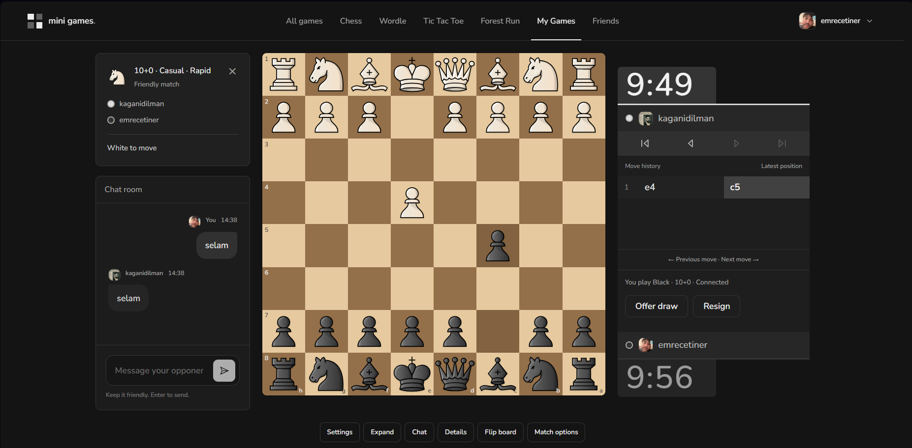
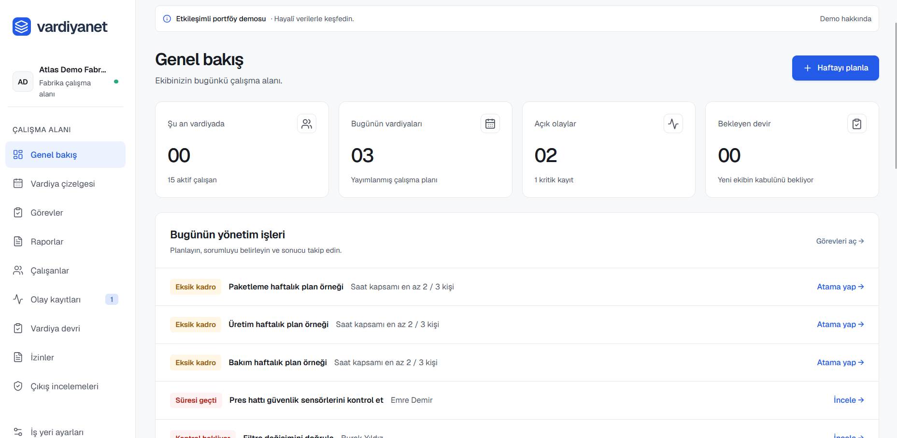
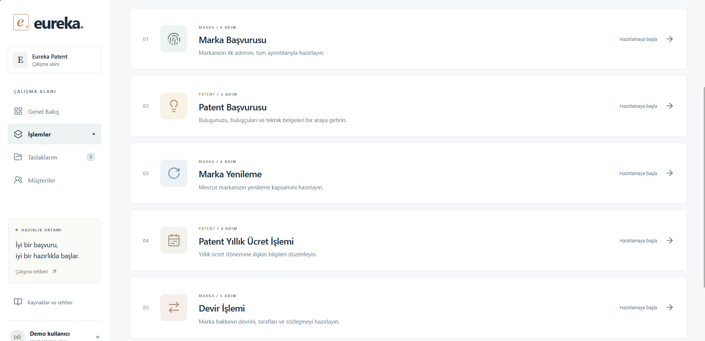

# Kağan İdilman

**Bilgisayar Mühendisliği 4. Sınıf Öğrencisi**

Web uygulamaları ve farklı alanlara yönelik yazılım projeleri geliştiriyorum. Kaynak kodlarını özel depolarda tuttuğum bazı projelerimin canlı sürümlerini burada paylaşıyorum.

---

## Projelerim

###  MiniGames

Satranç, Wordle ve XOX gibi oynamaktan hoşlandığım oyunları bir araya getirdiğim kişisel bir web projesi. Socket.IO kullanarak arkadaşlarla gerçek zamanlı satranç ve XOX maçları oynanabilen bir sistem geliştirdim. Satrançta Stockfish'e karşı oynama, farklı süre kontrolleri, arkadaş sistemi ve maç geçmişi gibi özellikler bulunuyor. Bunların yanında kendi 2D platform oyunumu da geliştiriyorum.

**[Canlı Siteyi Görüntüle](https://minigame-site-kagan-demo.vercel.app/)**

---

###  VardiyaNet

Fabrikaların vardiya planlama, personel, görev ve izin süreçlerini tek yerden yönetebilmesi için geliştirdiğim bir SaaS uygulaması. Yönetici, vardiya amiri ve çalışan rolleriyle günlük iş takibini ve vardiyalar arası bilgi aktarımını kolaylaştırmayı hedefliyorum. Projede Next.js, React, TypeScript, Tailwind CSS ve Supabase kullanıyorum.

**[Canlı Siteyi Görüntüle](https://vardiyanet-demo.vercel.app/)**

---

###  Eureka Patent

Marka ve patent işlemlerinin yönetimini tek bir çalışma alanında toplamaya yönelik geliştirdiğim demo uygulaması. Marka başvurusu, yenileme, devir ve patent yıllık ücret işlemleri için adım adım formlar içeriyor. Taslak yönetimi, belge kontrolleri ve mal/hizmet sınıflandırmasıyla başvuru hazırlık sürecini kolaylaştırmayı ve eksik bilgilerin erken fark edilmesini amaçlıyorum.

**[Canlı Demoyu Görüntüle](https://eureka-ip-demo.vercel.app/)**
